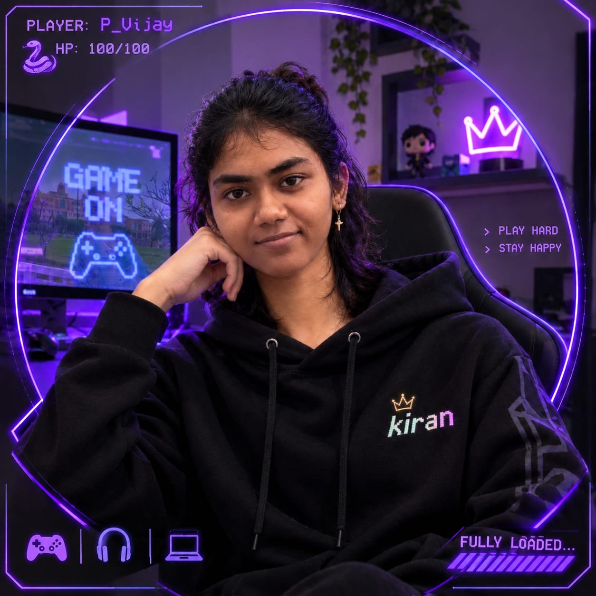

<div align="center">
  
</div>

<div align="center">
  
</div>

<br />

<div align="center">
  <a href="https://www.linkedin.com/in/priyanshu-v/"></a>
  <a href="mailto:priyanshuvijay262@gmail.com"></a>
  <a href="https://github.com/Butkii025"></a>
  <a href="https://www.kaggle.com/butkii"></a>
  <a href="https://p-vijay.vercel.app/"></a>
  
</div>

<br />


## 🎮 Player Profile

<table>
<tr>

<td width="40%" align="center" valign="top">



<sub>▰▰▰▰▰ <b>FULLY LOADED…</b></sub>
```text
╔═══════════════════════════════════════╗
║ PLAYER : P_Vijay                      ║
║ CLASS  : ML Engineer · Data Scientist ║
║ GUILD  : DSMNRU · B.Tech CSE          ║
║ LEVEL  : 06  (Semester VI complete)   ║
║ HP     : ████████████ 100/100         ║
║ CGPA   : ██████████░░ 8.30/10         ║
║ KIRAN  : █████████░░░ → LVL 07        ║
║ K-BOT  : Play Hard · Stay Happy       ║
╚═══════════════════════════════════════╝
```

</td>

<td width="60%" valign="top">


I'm Priyanshu Vijay, a Computer Science undergraduate at DSMNRU, Lucknow, and a Full-Stack AI/ML Engineer & Data Analyst. I build end-to-end machine learning systems, from data wrangling and predictive modeling to explainable dashboards and deployed web applications, that turn raw, messy data into decisions stakeholders can trust.

My work spans XGBoost and Random Forest modeling, NLP with Transformers, and full-stack delivery with Next.js and FastAPI, backed by three internships, two hackathon builds, and quantitative research presented at NCMPCS-2026. I am also participating in Google Summer of Code (GSoC) research.

**📍 Where I've put it to work**

* 🏆 **Hackathons:** *Smart India Hackathon 2026* · [Repo](https://github.com/Butkii025/BhuNirvighna-Ai) · [Live](https://bhunirvighna-ai.streamlit.app/) / *Google × Kaggle Hakathone 2026* · [Repo](https://github.com/Butkii025/LearnForge-AI) · [Writeup](https://www.kaggle.com/competitions/vibecoding-agents-capstone-project)
  
* 💼 **Internships:** *ElevatesLab* · [Repo](https://github.com/Butkii025/heart-disease-reading) / *BeeSkilled* · [Repo](https://github.com/Butkii025/Financial-Predictive-Modelling---intern)
* 🎓 **College & personal projects:** *Present Call* (face/voice biometrics) · [Live](https://presentcall.vercel.app/) | *CreditOptima* · [Live](https://creditoptima.streamlit.app)
* 🔬 **Research:** presented at NCMPCS-2026 · [Paper](https://p-vijay.vercel.app/research/Research-doc.PDF) · [Abstract](https://p-vijay.vercel.app/research/NCMPCS-abstract.PDF) · [Repo](https://github.com/Butkii025/Market-Reading)
* 🌍 **GSoC:** participating in **Google Summer of Code (GSoC)** research 2026

</td>
</tr>
</table>

### 📜 Quest Log

* 🔭 **Active quest:** building **BhuNirvighna-AI**, a land-acquisition delay-risk platform for the Ministry of Rural Development
* 🌍 **Open-source quest:** participating in Google Summer of Code (GSoC) research
* 🔬 **Side quest:** lead researcher on a Nifty 50 volatility forecasting model (**R² 0.9051**), presented at NCMPCS-2026 @ DSMNRU
* 📊 **Daily grind:** shipping predictive models and dashboards for real enterprise & government datasets
* 🌱 **Training arc:** markets, AI, MLOps, and motion design
* ☕ **Power-up:** no deploy ships without a cup of tea

<div align="center">

| 🎓 CGPA : **8.30** / 10 | 💼 Internships : **3+** | 🧊 Hackathons : **2+** | 🚀 Projects Built : **15+** |
|:---:|:---:|:---:|:---:|

**🏅 Unlocked Achievements**

   

`Pull Shark` · `Pair Extraordinaire` · `Quickdraw` · `YOLO`

</div>

🔗 [Portfolio](https://p-vijay.vercel.app/) · 📩 [Resume](https://docs.google.com/document/d/145I8HrBv9Ub2HroPFgFkyLaGp5p4T4UDzb6s-uII7Pk/export?format=pdf)

---

## 🌳 Skill Tree

<div align="center">

```text
AI/ML Engineering         ███████████░  19/20
Data Science & Analytics  ████████████  20/20
Data Eng. & ETL           ██████░░░░░░  10/20
Python Apps               ███████░░░░░  11/20
Game Algorithms           ██████░░░░░░  10/20
Web Development           ██████░░░░░░  10/20
Creative Design           █████░░░░░░░   8/20
Dev Tools & Deploy        ███████░░░░░  12/20
```

<sub>Bars show skills unlocked per domain (out of 20), as tracked on my <a href="https://p-vijay.vercel.app/#skills">portfolio</a>.</sub>

</div>

---

## ⚔️ Boss Fights (Featured Projects)

| Boss | Weapons | Loot |
|---|---|---|
| **[mini-txt - AI Text Summarizer](https://github.com/Butkii025/mini-txt)** | Python, Hugging Face Transformers, T5, Fly.io | Text summarization app built on Hugging Face's **T5 model**, containerized and deployed on **Fly.io** |
| **[Present Call - Biometric Attendance Engine](https://github.com/Butkii025/Present-Call-page)** | Python, Scikit-learn, Supabase, Resemblyzer, bcrypt | Mark a whole class's attendance from **one photo** or a **voice roll-call**; identity verified via face/voice **embeddings** (no raw images stored) with anti-spoofing & realtime sync · [Live Demo](https://presentcall.vercel.app/) |
| **[CreditOptima - Loan Approval System](https://github.com/Butkii025/CreditOptima)** | Python, Scikit-learn, Pandas, Streamlit | Logistic Regression / KNN / Naive Bayes compared at **~87% accuracy** · live approval predictions + model-comparison dashboard · [Live Demo](https://creditoptima.streamlit.app) |

<div align="center">
<sub>15+ quests cleared - explore the rest on my <a href="https://p-vijay.vercel.app/#projects">portfolio</a> or <a href="https://github.com/Butkii025?tab=repositories">repositories</a>.</sub>
</div>

<br/>

---

## 🎒 Inventory (Tech Stack)

<div align="center">

**⚡ Equipped Loadout**


</div>

<br/>

<table>
<tr><td>

**💬 Languages**

     

</td></tr>
<tr><td>

**🤖 AI / ML**

              

</td></tr>
<tr><td>

**📊 Data Science & Analytics**

        

</td></tr>
<tr><td>

**🌐 Web Engineering**

        

</td></tr>
<tr><td>

**🛠️ Developer Tools**

      

</td></tr>
</table>

---
## 📊 GitHub Analytics

<div align="center">
  <table border="0" cellspacing="0" cellpadding="0" width="100%">
    <tr>
      <td align="center" valign="top" width="50%">
        
      </td>
      <td align="center" valign="top" width="50%">
        
      </td>
    </tr>
    <tr>
      <td align="center" colspan="2">
        <br />
        
      </td>
    </tr>
  </table>
</div>

---

## 📈 Activity Graph

<div align="center">
  
</div>

---

## 🗂️ Profile Summary 

<div align="center">  </div> <br /> <div align="center">      </div> 

---

## 🤝 Join My Party

<div align="center">

I'm open to **Machine Learning Engineer**, **Data Scientist**, and **Data Analyst** roles - always happy to talk about data, models, or a good cup of chai.

<a href="https://www.linkedin.com/in/priyanshu-v/"></a>
<a href="mailto:priyanshuvijay262@gmail.com"></a>
<a href="https://p-vijay.vercel.app/"></a>
<a href="https://www.kaggle.com/butkii"></a>

</div>

---

<div align="center">
  <sub><b>▰▰▰▰▰▰▰▰▰▰ FULLY LOADED…</b> &nbsp;·&nbsp; 🎮 &nbsp;🎧 &nbsp;💻</sub>
  
  <sub>© 2026 Priyanshu, Built with data, design, and a sip of tea 🍵</sub>
</div>
